# CareSlot: Clinic Appointment Scheduling (DevSecOps capstone)

CareSlot is the front-desk system for a small multi-doctor clinic. Reception staff use it to register patients, manage which doctors are on duty, book appointments without double-booking a doctor, and move each visit through check-in to completion.

The app is small on purpose. The capstone is about the path it takes from a laptop to a monitored Kubernetes cluster: tests, containers, a CI/CD pipeline with security gates, a container registry, Terraform for AWS, Helm, GitOps with Argo CD, autoscaling, and Prometheus/Grafana.

| | |
|---|---|
| **Repository** | https://github.com/MadaraUchiha-tech/devsecops-python |
| **Images** | `ghcr.io/madarauchiha-tech/careslot-backend:<git-sha>`, `ghcr.io/madarauchiha-tech/careslot-frontend:<git-sha>` |
| **Demo material** | [`demo/`](demo/): slides, video, screenshots, terminal evidence |
| **Grading evidence** | [Section 14](#14-grading-evidence): every GRADING.md requirement with its screenshot and file links |

---

## 1. Architecture

```text
 Developer ── git push ──► GitHub (main)
                              │
                              ▼
                ┌──────── GitHub Actions ────────┐
                │ ruff + pytest │ npm build      │
                │ terraform validate │ helm lint │
                │ Trivy secret + misconfig scan  │
                │           │                    │
                │  docker build (backend, frontend)
                │           │                    │
                │  Trivy image scan ── HIGH/CRITICAL? ──► fail, nothing pushed
                │           │                    │
                │  push ghcr.io/...:<sha>        │
                │  kind cluster: helm install + API smoke test
                │  commit <sha> into helm/careslot/values.yaml
                └───────────┬────────────────────┘
                            │ (Git is the source of truth)
                            ▼
   Terraform ──► AWS VPC + EKS          Argo CD (in cluster) watches helm/careslot
                                                │ auto-sync, prune, self-heal
                                                ▼
              ┌──────────────── namespace: careslot ────────────────┐
  browser ──► │ Ingress (nginx)                                     │
              │   /      ──► frontend Service ──► Nginx pods (x2)   │
              │   /api   ──► backend Service  ──► FastAPI pods (2-6, HPA)
              │                                    │                │
              │                       PostgreSQL StatefulSet + PVC  │
              └───────────────────────┬──────────────────────────────┘
                                      │ /metrics (ServiceMonitor)
                            Prometheus ──► Grafana dashboard
```

### Components

| Component | What it does |
|---|---|
| **Frontend** (`frontend/`) | React 19 + Vite. Day schedule with check-in/complete/cancel actions, a booking form that shows double-booking conflicts, doctor workload, patient search and registration, doctor availability. Served by unprivileged Nginx, which also proxies `/api` when there is no Ingress. |
| **Backend** (`backend/`) | FastAPI + SQLAlchemy 2. REST API for doctors, patients, appointments. Enforces the appointment status workflow and rejects overlapping bookings for the same doctor. Exposes `/health`, `/ready` and `/metrics`. |
| **Database** | PostgreSQL 16. Schema owned by Alembic (`backend/alembic/versions/`). |
| **Infrastructure** (`terraform/`) | VPC (2 public + 2 private subnets, NAT) and EKS (managed node group, KMS secrets encryption) in `ap-south-1`. |
| **Deployment** (`helm/careslot/`) | Helm chart: Deployments, Services, StatefulSet, Ingress, HPA, ServiceMonitor, Grafana dashboard. |
| **GitOps** (`argocd/`) | Argo CD `Application` that keeps the cluster in sync with `helm/careslot` on `main`. |
| **Observability** (`monitoring/`) | kube-prometheus-stack values (Prometheus + Grafana). |

---

## 2. Tech stack

| Layer | Tools |
|---|---|
| Languages | Python 3.12, JavaScript (React 19), HCL, YAML, Bash |
| Backend | FastAPI, SQLAlchemy 2, Alembic, Pydantic v2, Uvicorn, prometheus-fastapi-instrumentator |
| Frontend | React, Vite, Lucide icons, Atkinson Hyperlegible (self-hosted) |
| Database | PostgreSQL 16 |
| Testing / quality | pytest, pytest-cov, httpx TestClient, Ruff (lint + format) |
| Containers | Docker (multi-stage), Docker Compose, nginx-unprivileged |
| CI/CD | GitHub Actions, GitHub Container Registry (GHCR) |
| Security | Trivy (image CVEs, secrets, IaC misconfiguration), SARIF to GitHub Security, non-root containers, Pod Security Admission |
| Infrastructure | Terraform, AWS VPC, EKS, IAM, KMS, CloudWatch Logs |
| Kubernetes | Helm 3, ingress-nginx, HPA + metrics-server, Argo CD |
| Observability | Prometheus Operator (kube-prometheus-stack), Grafana |

---

## 3. Application

### REST API

Swagger UI is at `/docs` when the backend runs.

| Method | Path | Purpose |
|---|---|---|
| GET | `/health` | Liveness: process is up |
| GET | `/ready` | Readiness: database reachable (503 otherwise) |
| GET | `/metrics` | Prometheus metrics |
| GET / POST | `/api/doctors` | List (optionally `?active_only=true`) / add doctors |
| GET / PUT / DELETE | `/api/doctors/{id}` | Read / update (e.g. go off duty) / remove |
| GET / POST | `/api/patients` | List and search (`?q=`) / register patients |
| GET / PUT / DELETE | `/api/patients/{id}` | Read / update / remove |
| GET / POST | `/api/appointments` | List (filter by `on_date`, `doctor_id`, `patient_id`, `status_filter`) / book |
| GET / PUT / DELETE | `/api/appointments/{id}` | Read / reschedule or change status / delete |
| GET | `/api/appointments/stats` | Totals by status, today's count, per-doctor workload |

**Business rules**

- A doctor cannot have two active appointments that overlap. Booking or rescheduling into a taken slot returns **409** with the clashing appointment. Cancelled and no-show slots free up again.
- Status workflow: `SCHEDULED → CHECKED_IN → COMPLETED`, and `SCHEDULED → CANCELLED | NO_SHOW`, `CHECKED_IN → CANCELLED`. Completed, cancelled and no-show are final. Anything else returns **409**.
- Only active doctors can be booked. Patient emails are unique.

**Custom metrics** (besides the standard HTTP request and latency metrics):
`careslot_appointments_booked_total{specialty}`, `careslot_appointment_status_changes_total{to_status}`, `careslot_booking_conflicts_total`.

### Data model

```text
doctors (id, full_name, specialty, room, active, created_at)
patients (id, full_name, email UNIQUE, phone, date_of_birth, created_at)
appointments (id, patient_id → patients, doctor_id → doctors, scheduled_at, duration_minutes,
              reason, status, notes, created_at, updated_at)
```

---

## 4. Run it locally

### Docker Compose (one command)

Requirements: Docker Desktop or Docker Engine with Compose v2.

```bash
docker compose up --build
```

| URL | What |
|---|---|
| http://localhost:3000 | CareSlot UI |
| http://localhost:8000/docs | Swagger UI |
| http://localhost:8000/health, `/ready`, `/metrics` | Probes and metrics |

Compose waits for Postgres to be healthy, runs Alembic migrations, seeds demo doctors, patients and appointments (`SEED_DEMO_DATA=true`), then starts the frontend after the backend's healthcheck passes.

```bash
docker compose down        # stop
docker compose down -v     # stop and delete the database volume
```

### Backend without Docker

```bash
cd backend
python3.12 -m venv .venv && source .venv/bin/activate
pip install -r requirements-dev.txt
cp .env.example .env                     # points at localhost:5432
alembic upgrade head && python -m app.seed
uvicorn app.main:app --reload --port 8000
```

### Frontend dev server

```bash
cd frontend && npm ci && npm run dev     # http://localhost:5173, proxies /api to :8000
```

---

## 5. Testing and code quality

```bash
cd backend
pytest -v --cov=app      # 21 tests, ~94% coverage
ruff check . && ruff format --check .
```

- Tests never touch Postgres. `tests/conftest.py` overrides FastAPI's `get_db` dependency with an in-memory SQLite engine and creates a fresh schema for every test.
- Coverage: health/readiness/metrics, doctor and patient CRUD, validation errors, duplicate email, booking, double-booking rejection, rebooking a cancelled slot, the status workflow, rescheduling conflicts, stats, and the idempotent seeder.
- In CI, a failing test or lint error stops the pipeline before any image is built.

---

## 6. Docker

| Image | Build | Runtime user | Notes |
|---|---|---|---|
| `backend/Dockerfile` | Multi-stage: build a venv, copy it into a clean `python:3.12-slim` | `appuser` (uid 10001) | pip/setuptools removed from the runtime image; `HEALTHCHECK` on `/health`; runs `alembic upgrade head`, the seeder, then Uvicorn |
| `frontend/Dockerfile` | Multi-stage: `node:22-alpine` runs `npm ci && npm run build`, then `nginxinc/nginx-unprivileged:1.29-alpine` serves `dist/` | `nginx` (uid 101), port 8080 | `BACKEND_URL` injected into the Nginx config with envsubst, so one image works in Compose and Kubernetes; security headers |

---

## 7. CI/CD pipeline

Workflow: [`.github/workflows/ci-cd.yml`](.github/workflows/ci-cd.yml). It runs on every push and pull request to `main`. Registry pushes, deployment and GitOps steps only run on pushes to `main`.

```text
backend-test ─┐
frontend-build├─► build-scan-push (matrix: backend, frontend) ─► deploy-smoke-test ─► gitops-promote
iac-validate  │      build → Trivy (gate) → SARIF → push :<sha>     kind + helm + API test   values.yaml ← <sha>
security-scan ┘
```

| Job | What it proves |
|---|---|
| **backend-test** | Ruff lint and format, then pytest with coverage. JUnit and coverage XML uploaded as artifacts. |
| **frontend-build** | `npm ci && npm run build` succeeds; `dist/` uploaded. |
| **iac-validate** | `terraform fmt -check`, `terraform validate`, `helm lint`, `helm template`. |
| **security-scan** | Trivy secret scan (blocking) and a Terraform/Helm/Dockerfile misconfiguration report (advisory). |
| **build-scan-push** | Builds each image once, tagged `ghcr.io/madarauchiha-tech/careslot-<component>:<git-sha>`. Trivy fails the job on fixable HIGH/CRITICAL CVEs. Only images that pass are pushed. No `latest` tag is ever pushed. |
| **deploy-smoke-test** | Creates a throwaway kind cluster, `helm upgrade --install`s the chart with the SHA-tagged images from GHCR, waits for readiness, then books an appointment through the API. |
| **gitops-promote** | Writes the SHA into `helm/careslot/values.yaml` and commits it with `[skip ci]`. Argo CD picks the commit up and rolls the cluster forward. |

The commit SHA in the image tag traces a running pod back to its exact source: `kubectl get deploy careslot-backend -o jsonpath='{..image}'`.

---

## 8. DevSecOps: Trivy

Trivy runs at three points in the pipeline:

1. **Container images.** Both images are scanned before they are pushed. `--severity HIGH,CRITICAL --ignore-unfixed --exit-code 1` fails the build only for vulnerabilities that have a fix available, so the team can act on every failure. A SARIF report (MEDIUM and above) goes to the repository's Security tab.
2. **Secrets.** `trivy fs --scanners secret` fails the build if a credential pattern (AWS keys, tokens, private keys) is committed.
3. **IaC misconfiguration.** Terraform, Helm and Dockerfiles are checked and reported.

**A real finding from this project.** The first backend build pinned FastAPI 0.118, which pulled in Starlette 0.48.0. Trivy failed the image on **CVE-2025-62727**, a HIGH-severity denial of service: a request with many overlapping `Range` header values made Starlette do quadratic work when merging them, so a few requests could pin a CPU. Fixed in Starlette 0.49.1. The same scan flagged HIGH CVEs in `urllib3` and `setuptools` that came from pip's vendored copies, which the app never uses at runtime. Fix (commit `fix(security): …`): upgrade FastAPI/Starlette and remove pip and setuptools from the runtime image. Both images now scan with **0** fixable HIGH/CRITICAL vulnerabilities.

The misconfiguration scan led to two more fixes: EKS secrets are now encrypted with a KMS key (AWS-0039), and the Postgres container uses a read-only root filesystem (KSV-0014). The remaining advisory findings are accepted for the demo: public EKS API endpoint (restrict `cluster_endpoint_public_access_cidrs` in real use), open egress, and public IPs in the public subnets.

Other controls: every container runs as non-root with `allowPrivilegeEscalation: false`, all capabilities dropped and (where possible) a read-only root filesystem. The namespace enforces the Pod Security `baseline` profile and warns on `restricted`. Database credentials live in a Kubernetes Secret. No AWS credentials are committed anywhere.

---

## 9. Terraform: AWS infrastructure

```text
terraform/
├── versions.tf               provider + (commented) S3/DynamoDB remote state
├── variables.tf              region, CIDR, AZ count, k8s version, node sizes
├── main.tf                   wires the two modules together
├── outputs.tf                VPC/subnet IDs, cluster name/endpoint, kubeconfig command
├── terraform.tfvars.example  copy to terraform.tfvars (git-ignored)
├── modules/vpc/              VPC, IGW, 2 public + 2 private subnets, NAT, route tables
├── modules/eks/              IAM roles, KMS key, log group, EKS cluster, managed node group
└── mock/provider_override.tf used only by scripts/terraform-mock.sh
```

| Resource | Detail |
|---|---|
| VPC | `10.20.0.0/16`, DNS hostnames on |
| Public subnets | `10.20.101.0/24`, `10.20.102.0/24` in `ap-south-1a/b`, tagged `kubernetes.io/role/elb` |
| Private subnets | `10.20.1.0/24`, `10.20.2.0/24`, tagged `kubernetes.io/role/internal-elb`, routed through one NAT gateway |
| EKS | `careslot-dev`, Kubernetes 1.33, API + audit + authenticator logs, KMS-encrypted Secrets, access entries with creator admin |
| Node group | `careslot-dev-main`, `t3.medium`, min 2 / desired 2 / max 4, private subnets only |

### Against real AWS

```bash
cd terraform
cp terraform.tfvars.example terraform.tfvars     # credentials come from `aws configure`, never from this file
terraform init
terraform plan
terraform apply
aws eks update-kubeconfig --region ap-south-1 --name careslot-dev
# ... deploy, demo ...
terraform destroy
```

Cost: the EKS control plane, two t3.medium nodes and a NAT gateway come to about $0.25–0.30 per hour in ap-south-1. Destroy after the evaluation.

### Local run

The demo lifecycle was run locally with `scripts/terraform-mock.sh`, which points the AWS provider at a local AWS API ([moto](https://github.com/getmoto/moto)):

```bash
scripts/terraform-mock.sh plan      # Plan: 28 to add, 0 to change, 0 to destroy
scripts/terraform-mock.sh apply     # Apply complete! Resources: 28 added
scripts/terraform-mock.sh destroy   # Destroy complete! Resources: 28 destroyed
scripts/terraform-mock.sh down      # stop the local API, remove the override
```

Captured output is in [`demo/evidence/`](demo/evidence/): `terraform-plan.txt`, `terraform-apply.txt`, `aws-resources-mock.txt` (VPC, subnets, EKS cluster and node group as AWS CLI tables) and `terraform-destroy.txt`.

---

## 10. Kubernetes and Helm

The application runs on a local **minikube** cluster (ingress and metrics-server add-ons) in place of EKS. The chart is cluster-agnostic: `values-prod.yaml` holds the EKS sizing.

### Chart layout

```text
helm/careslot/
├── Chart.yaml
├── values.yaml          images (tag = git SHA, written by CI), replicas, resources, HPA, ingress, monitoring
├── values-local.yaml    minikube/kind (host careslot.local)
├── values-prod.yaml     EKS sizing; turn off demo seed data
├── dashboards/careslot.json
└── templates/
    ├── backend.yaml          Deployment (wait-for-db init container, startup/readiness/liveness probes) + ClusterIP Service :8000
    ├── frontend.yaml         Deployment (2 replicas) + ClusterIP Service :80 → 8080
    ├── postgres.yaml         StatefulSet + PVC + ClusterIP Service :5432
    ├── secret.yaml           DB credentials and DATABASE_URL
    ├── ingress.yaml          /api → backend, / → frontend
    ├── hpa.yaml              backend 2–6 replicas at 60% CPU
    ├── servicemonitor.yaml   Prometheus scrape of /metrics
    └── grafana-dashboard.yaml
```

### Deploy

```bash
# 1. cluster (local) – or `aws eks update-kubeconfig ...` for EKS
minikube start --cpus=6 --memory=6500 --addons=ingress,metrics-server -p careslot

# 2. namespace, pod security, quota
kubectl apply -f k8s/namespace.yaml -f k8s/resource-quota.yaml

# 3a. GitOps (what the demo uses): install Argo CD and register the app
kubectl create namespace argocd
kubectl apply -n argocd --server-side -f https://raw.githubusercontent.com/argoproj/argo-cd/v3.5.4/manifests/install.yaml
kubectl apply -f argocd/careslot-application.yaml

# 3b. or plain Helm (the demo runs a second, Helm-managed copy as careslot-staging)
helm upgrade --install careslot-staging helm/careslot -n careslot-staging --create-namespace \
  --set ingress.host=staging.careslot.local --set monitoring.serviceMonitor.enabled=false

# 4. check
kubectl get pods,svc,ingress,hpa -n careslot
helm list -n careslot
```

Reach the Ingress: add `127.0.0.1 careslot.local grafana.careslot.local` to `/etc/hosts`, then run `minikube tunnel -p careslot` (or `kubectl -n ingress-nginx port-forward svc/ingress-nginx-controller 8080:80` and browse to `http://careslot.local:8080`).

### GitOps flow with Argo CD

1. A developer pushes to `main`.
2. CI tests, scans and pushes `careslot-*:<sha>`, then commits `<sha>` into `helm/careslot/values.yaml`.
3. Argo CD polls the repository, sees `values.yaml` change, renders the chart and applies the difference: a rolling update with `maxUnavailable: 0`.
4. `selfHeal` reverts manual `kubectl` edits; `prune` removes resources deleted from Git. Rollback is `git revert`.

### Autoscaling

The HPA keeps the backend between 2 and 6 replicas at 60% average CPU (metrics-server supplies the numbers). To demonstrate it:

```bash
URL=http://careslot.local:8080 scripts/load-test.sh     # hammers the API with concurrent requests
kubectl get hpa careslot-backend -n careslot -w
```

### Troubleshooting lab

[`troubleshooting/`](troubleshooting/) has a broken image (ImagePullBackOff) and a Service with no endpoints, with step-by-step diagnosis and a table of the bugs found and fixed in the TaskBoard starter.

---

## 11. Observability

```bash
helm repo add prometheus-community https://prometheus-community.github.io/helm-charts
helm upgrade --install kube-prometheus-stack prometheus-community/kube-prometheus-stack \
  -n monitoring --create-namespace -f monitoring/prometheus-values.yaml
```

- **Prometheus** finds the backend through the chart's `ServiceMonitor` (label `release: kube-prometheus-stack`, port `http`, path `/metrics`, every 15s). Each backend pod appears as a target on *Status → Targets*.
- **Grafana** (`kubectl -n monitoring port-forward svc/kube-prometheus-stack-grafana 3001:80`, user `admin`, password from `monitoring/prometheus-values.yaml`) loads the **CareSlot – Application Overview** dashboard automatically from the chart's ConfigMap:
  - requests/sec, p95 latency, 5xx error ratio, live backend pod count
  - requests by endpoint; latency p50/p95/p99; responses by status class
  - backend CPU per pod (the HPA's input)
  - appointments booked by specialty; status changes and rejected double-bookings

---

## 12. Repository layout

```text
.
├── backend/            FastAPI app, Alembic migrations, pytest suite, Dockerfile
├── frontend/           React app, Nginx template, Dockerfile
├── docker-compose.yml  local three-service stack
├── .github/workflows/  CI/CD pipeline
├── terraform/          AWS VPC + EKS (modules) and mock runner override
├── helm/careslot/      Helm chart
├── k8s/                namespace, pod security labels, quota/limits
├── argocd/             Argo CD Application (GitOps)
├── monitoring/         kube-prometheus-stack and Grafana values
├── scripts/            load test, Terraform mock runner
├── troubleshooting/    break/fix lab
└── demo/               slides, video, screenshots, evidence
```

---

## 13. Known issues and limitations

- **PostgreSQL runs inside the cluster** as a single-replica StatefulSet. That's fine for a demo, but production should use Amazon RDS (Multi-AZ, automated backups). Set `postgres.enabled=false` and point `DATABASE_URL` at RDS.
- **Demo secrets.** The Postgres and Grafana passwords in the values files are demo defaults. In production use External Secrets / AWS Secrets Manager or Sealed Secrets.
- **No authentication.** The front-desk UI and API are open. A real deployment needs SSO/OIDC in front of the Ingress and role-based access, and the patient data would fall under health-data regulations.
- **Times are stored in UTC** and shown in the browser's time zone. The schedule's day view uses UTC day boundaries.
- **GHCR visibility.** Packages published from Actions may start out private. Make them public (package settings), or give the cluster an `imagePullSecret`, which the CI smoke test does.
- Single NAT gateway and a public EKS endpoint keep costs down. Production would use one NAT per AZ and a restricted or private endpoint.

---

## 14. Grading evidence

Every requirement from [GRADING.md](GRADING.md), with the evidence inline. Screenshot files are in [`demo/screenshots/`](demo/screenshots/), raw terminal output in [`demo/evidence/`](demo/evidence/).

| Module | Requirement → where it is | Status |
|---|---|---|
| [M1 Application](#m1-application) | 16 REST endpoints, Postgres, Alembic migration, React UI | ✅ |
| [M2 Testing](#m2-testing) | 21 pytest tests, 94% coverage, SQLite test DB, Ruff | ✅ |
| [M3 Git](#m3-git-and-github) | 40+ commits, conventional messages | ✅ |
| [M4 Docker](#m4-docker) | Multi-stage, non-root, `docker compose up --build`, app on :3000 | ✅ |
| [M5 CI/CD](#m5-cicd) | Green run, GHCR images tagged with the commit SHA | ✅ |
| [M6 DevSecOps](#m6-devsecops-trivy) | Trivy gate on both images, a real CVE found and fixed | ✅ |
| [M7 Terraform](#m7-terraform) | VPC + EKS modules, plan / apply / destroy, tfvars example | ✅ |
| [M8 Kubernetes + Helm](#m8-kubernetes-and-helm) | Pods Running, Services, Ingress, `helm list`, HPA, Argo CD | ✅ |
| [M9 Observability](#m9-observability) | `/metrics`, Prometheus targets UP, Grafana dashboard | ✅ |
| [M10 Presentation](#m10-presentation-and-documentation) | Video, slide deck, this README | ✅ |

### M1 Application

| Required | Where |
|---|---|
| Backend source (models, schemas, routes, DB config) | [`backend/app/`](backend/app/): [`models.py`](backend/app/models.py), [`schemas.py`](backend/app/schemas.py), [`routers/`](backend/app/routers/), [`db.py`](backend/app/db.py), [`config.py`](backend/app/config.py) |
| At least 4 REST endpoints | 16 under `/api`, listed in [section 3](#rest-api) |
| Alembic migration | [`backend/alembic/versions/0001_create_clinic_schema.py`](backend/alembic/versions/0001_create_clinic_schema.py) |
| `requirements.txt` | [`backend/requirements.txt`](backend/requirements.txt) |
| Frontend source | [`frontend/src/`](frontend/src/) |
| `docker-compose.yml` | [`docker-compose.yml`](docker-compose.yml) |
| App running in the browser | Screenshots below; also the video [`demo/careslot-presentation.mp4`](demo/careslot-presentation.mp4) |

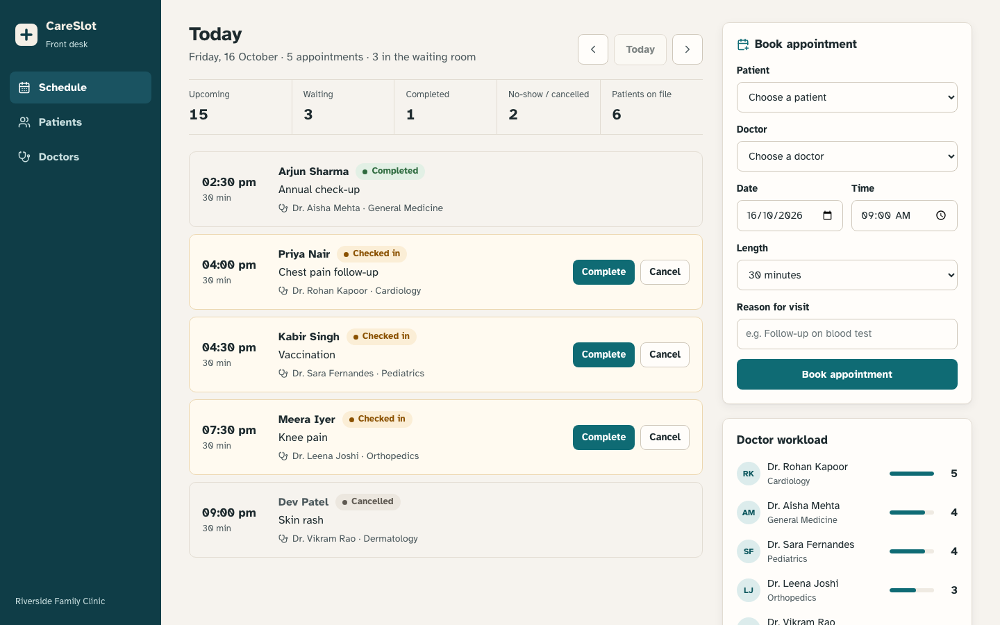 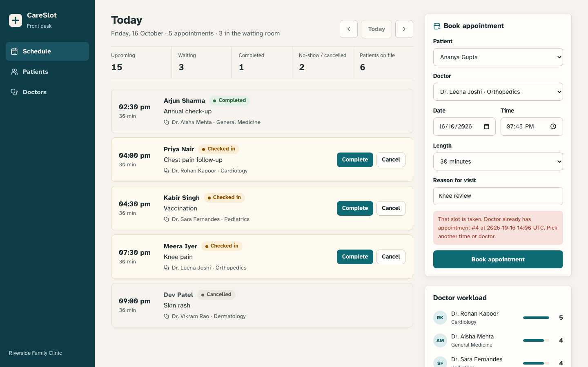
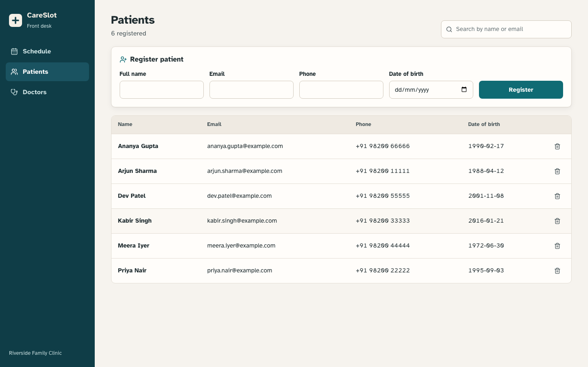 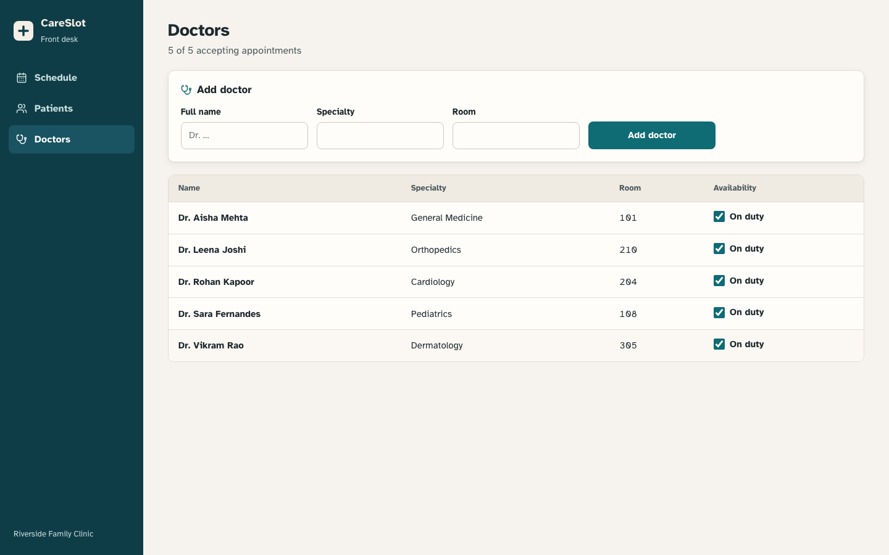
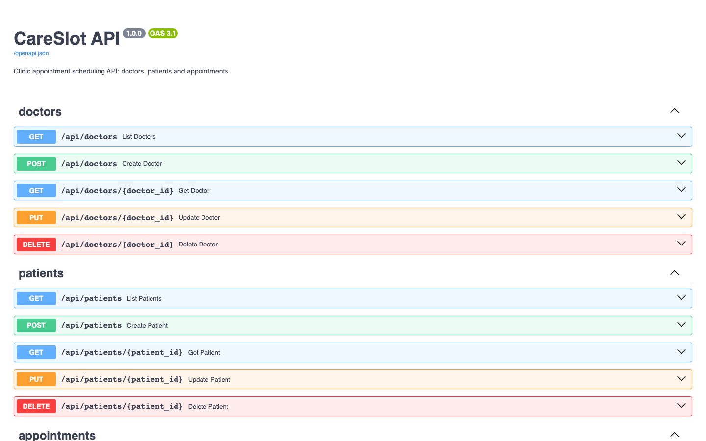 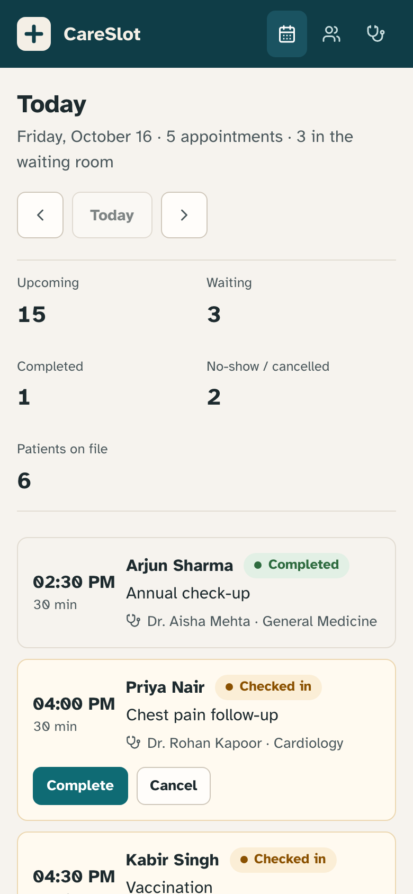

### M2 Testing

| Required | Where |
|---|---|
| Test files | [`backend/tests/`](backend/tests/): `test_appointments.py` (10), `test_doctors_patients.py` (7), `test_meta.py` (4) |
| `pytest.ini` / `conftest.py` | [`backend/pytest.ini`](backend/pytest.ini), [`backend/tests/conftest.py`](backend/tests/conftest.py) |
| Test DB, not production | `conftest.py` overrides `get_db` with in-memory SQLite (`StaticPool`); Postgres is never touched |
| `pytest -v` passing | Screenshot below · raw: [`demo/evidence/pytest-ci.txt`](demo/evidence/pytest-ci.txt) |

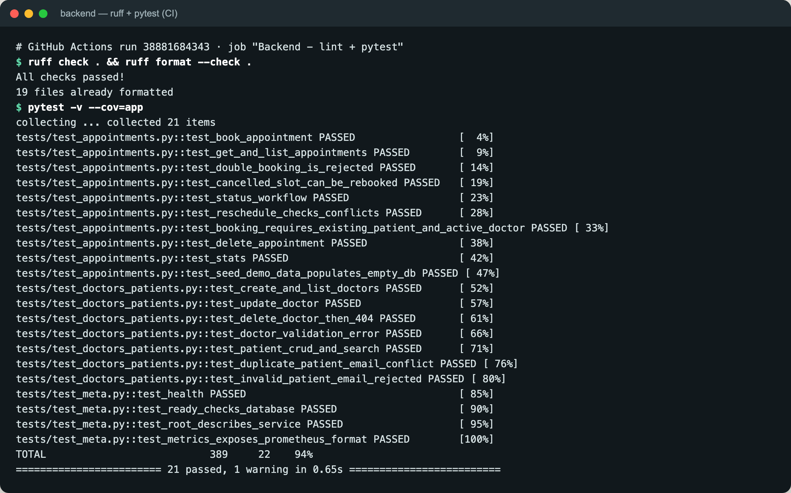

### M3 Git and GitHub

| Required | Where |
|---|---|
| Repository URL | https://github.com/MadaraUchiha-tech/devsecops-python |
| 10+ commits | [Commit history](https://github.com/MadaraUchiha-tech/devsecops-python/commits/main): 40+ commits, conventional `feat/fix/ci/docs` messages |

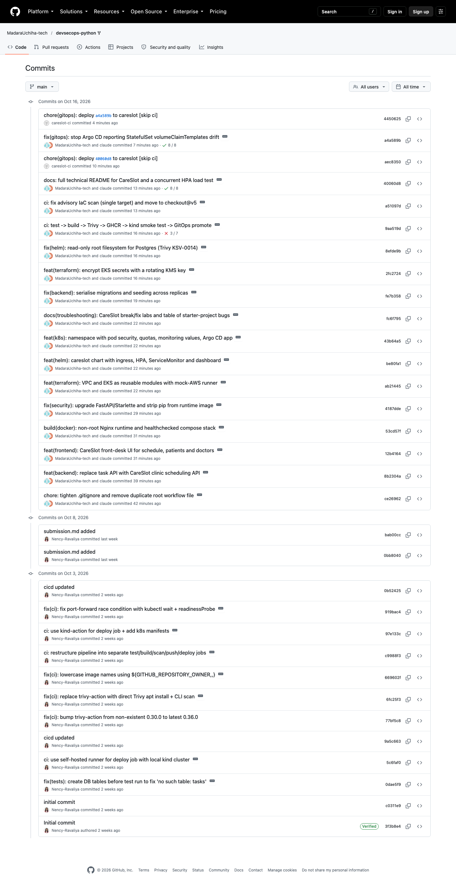 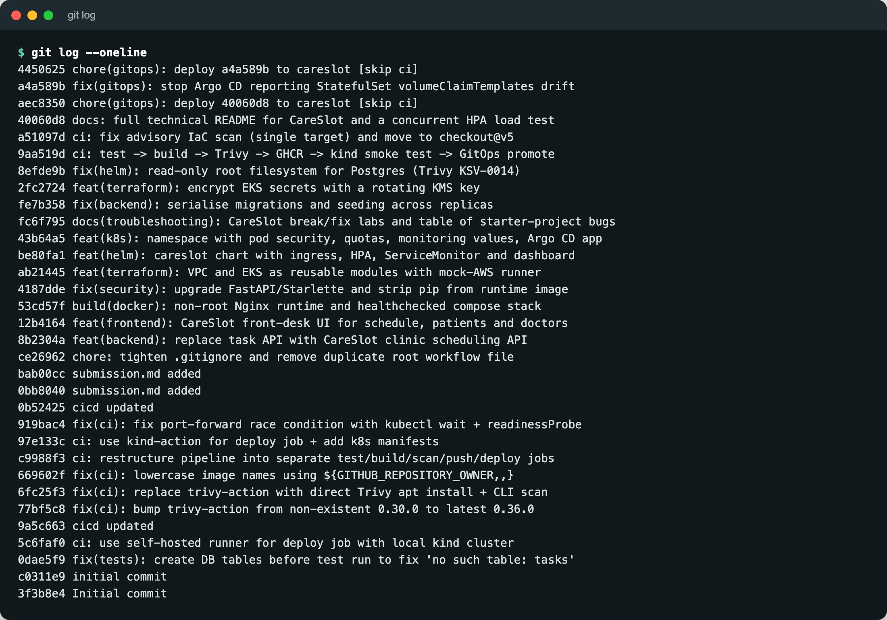

### M4 Docker

| Required | Where |
|---|---|
| `backend/Dockerfile` | [`backend/Dockerfile`](backend/Dockerfile): multi-stage, runs as uid 10001, pip/setuptools stripped |
| `frontend/Dockerfile` | [`frontend/Dockerfile`](frontend/Dockerfile): multi-stage (Node build → nginx-unprivileged), runs as uid 101 |
| `docker-compose.yml` | [`docker-compose.yml`](docker-compose.yml): Postgres + backend + frontend with healthchecks |
| `docker compose up --build` output | Screenshot below · raw: [`demo/evidence/docker-compose-up.txt`](demo/evidence/docker-compose-up.txt) |
| Browser at `http://localhost:3000` | Screenshot below |

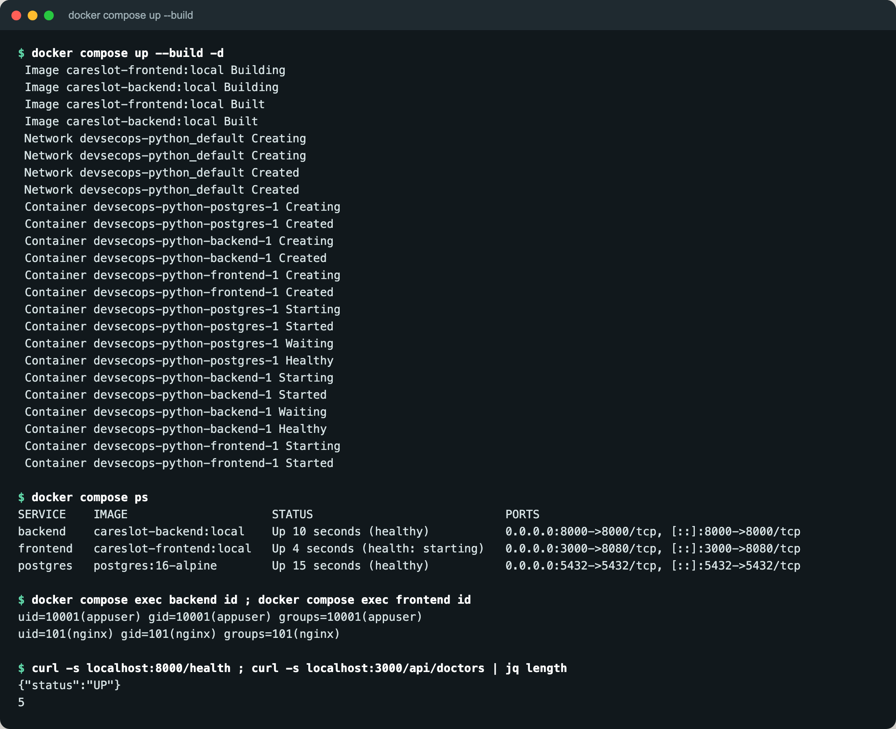 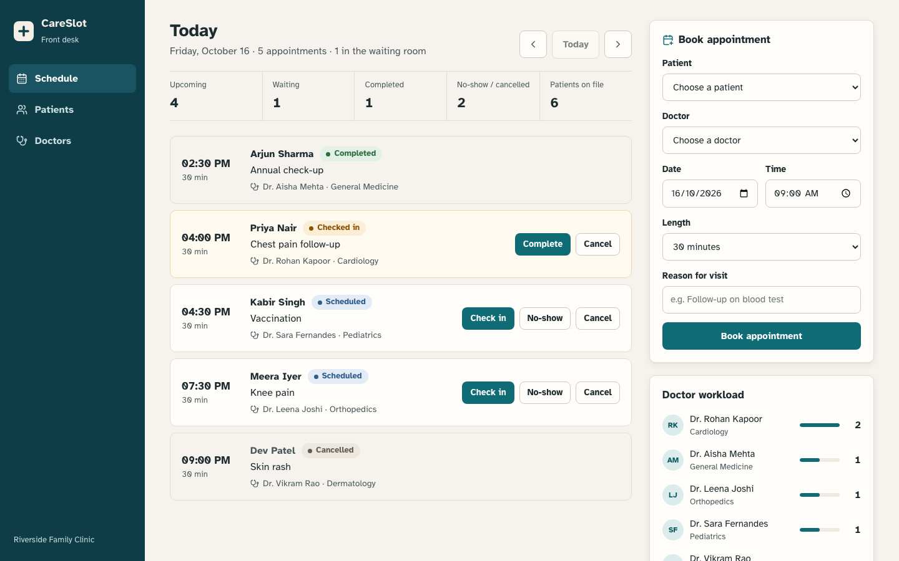
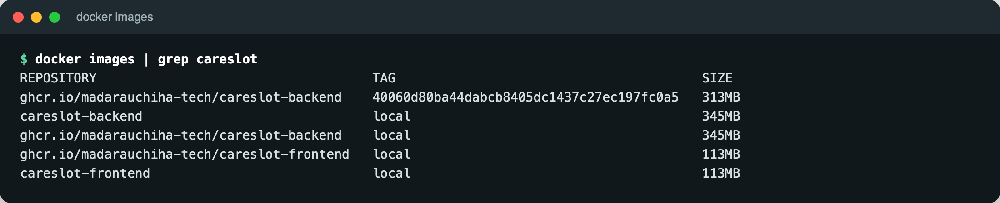

### M5 CI/CD

| Required | Where |
|---|---|
| Workflow YAML | [`.github/workflows/ci-cd.yml`](.github/workflows/ci-cd.yml) |
| Green pipeline run URL | https://github.com/MadaraUchiha-tech/devsecops-python/actions/runs/38923171625 (all 8 jobs green) · [all runs](https://github.com/MadaraUchiha-tech/devsecops-python/actions) |
| GHCR images with SHA tags | [careslot-backend](https://github.com/users/MadaraUchiha-tech/packages/container/package/careslot-backend) · [careslot-frontend](https://github.com/users/MadaraUchiha-tech/packages/container/package/careslot-frontend) |

Pipeline: lint + pytest, frontend build, `terraform validate` + `helm lint`, secret scan → build both images → Trivy gate → push to GHCR as `:<commit-sha>` → Helm install on a kind cluster + API smoke test → CI writes the SHA into `helm/careslot/values.yaml` for Argo CD. Details in [section 7](#7-cicd-pipeline).

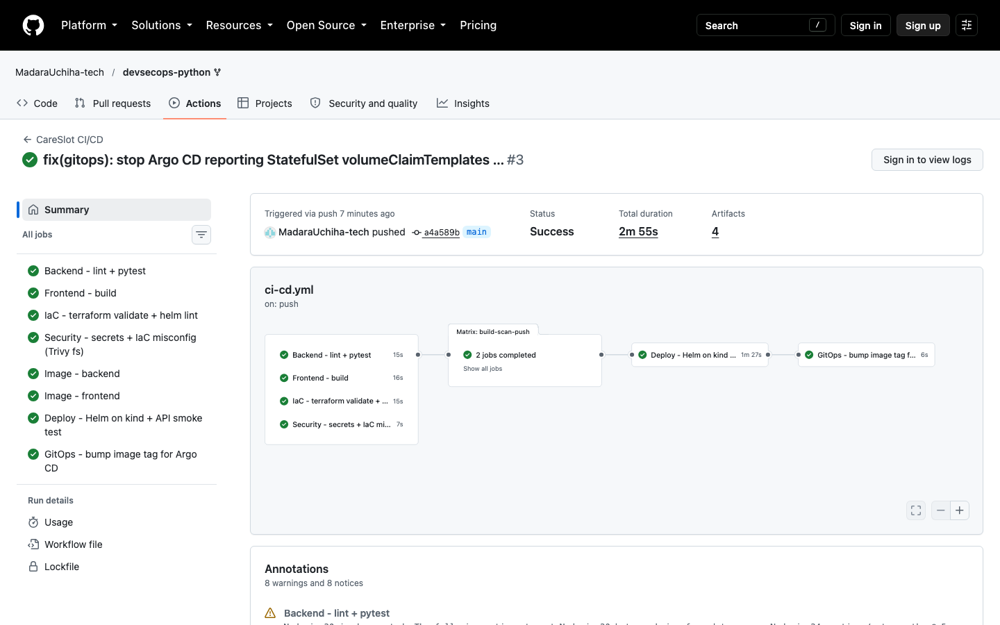 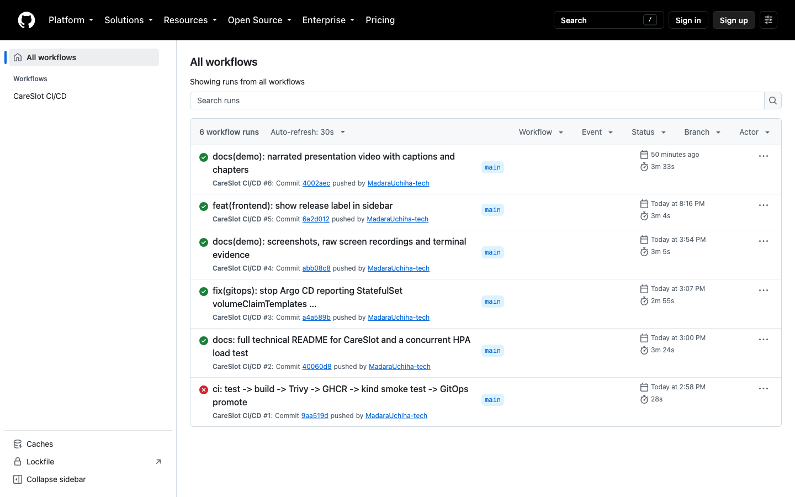
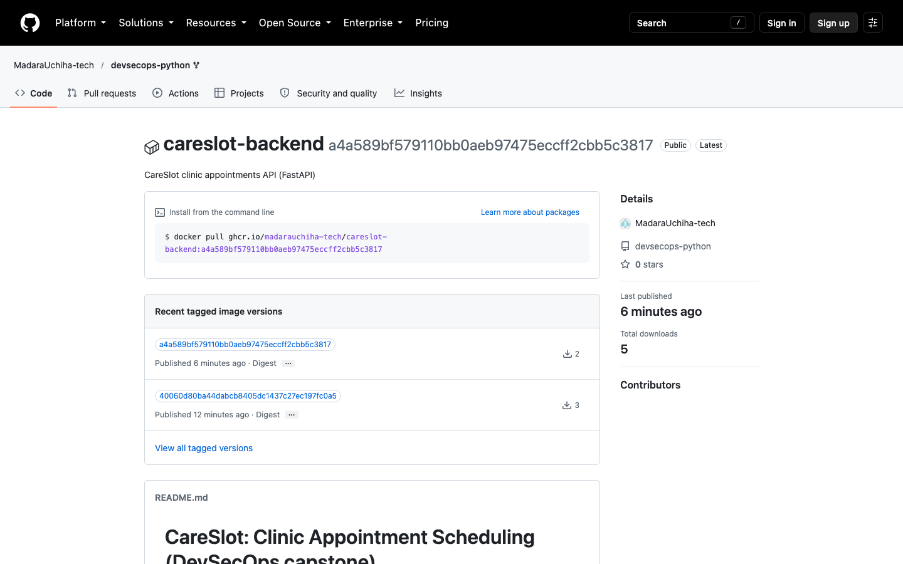 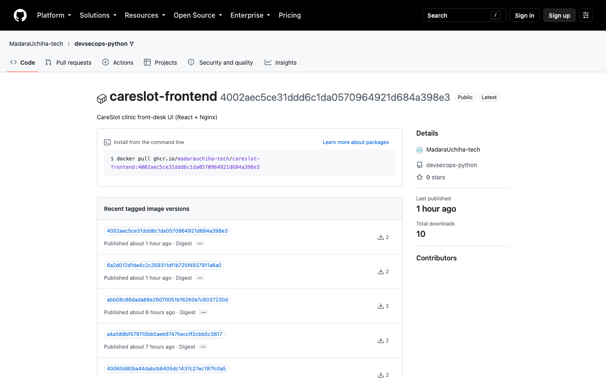

### M6 DevSecOps Trivy

| Required | Where |
|---|---|
| Trivy step in the workflow | [`ci-cd.yml`](.github/workflows/ci-cd.yml), job `build-scan-push`, step "Trivy scan - fail on fixable HIGH/CRITICAL CVEs" (both images, matrix) |
| Fails on HIGH/CRITICAL | `trivy image --severity HIGH,CRITICAL --ignore-unfixed --exit-code 1` |
| Scan output screenshot | Below · raw: [`trivy-before-fix.txt`](demo/evidence/trivy-before-fix.txt), [`trivy-ci-backend.txt`](demo/evidence/trivy-ci-backend.txt), [`trivy-ci-frontend.txt`](demo/evidence/trivy-ci-frontend.txt) |
| No secrets committed | `trivy fs --scanners secret --exit-code 1` runs on every push; `terraform.tfvars` is git-ignored |

**What Trivy scanned and what the result means.** Trivy scanned both images in CI: the Debian OS packages and every Python package in the backend, and the Alpine packages in the Nginx frontend. The first backend build failed on 7 HIGH findings, including **CVE-2025-62727**, a denial of service in Starlette 0.48.0 where many overlapping HTTP `Range` headers cost quadratic CPU time. After upgrading FastAPI/Starlette and removing pip/setuptools from the runtime image, both images report **0** fixable HIGH/CRITICAL vulnerabilities, so CI pushes them to GHCR.

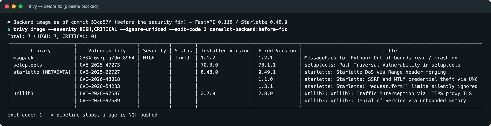
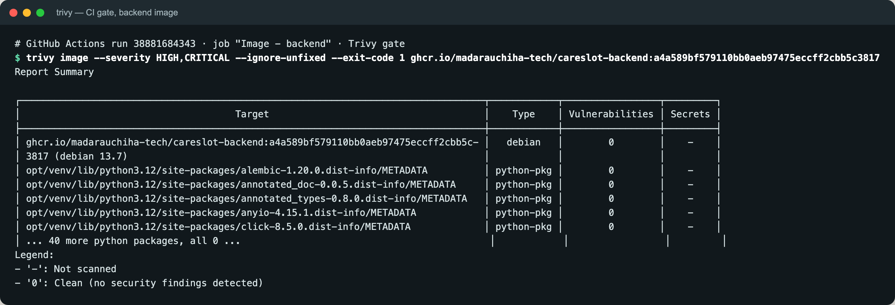 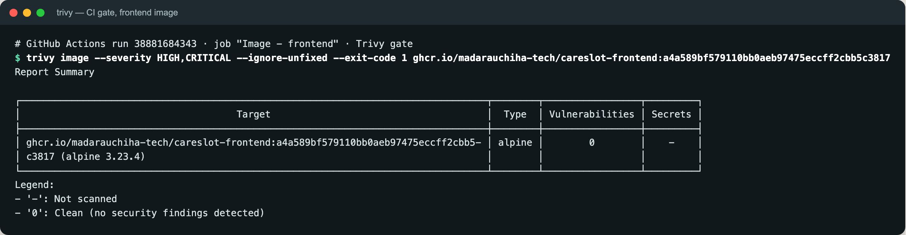

### M7 Terraform

| Required | Where |
|---|---|
| `.tf` files | [`terraform/`](terraform/): [`main.tf`](terraform/main.tf), [`variables.tf`](terraform/variables.tf), [`outputs.tf`](terraform/outputs.tf), [`versions.tf`](terraform/versions.tf), [`modules/vpc`](terraform/modules/vpc/), [`modules/eks`](terraform/modules/eks/) |
| VPC with 2+ public subnets | `10.20.0.0/16`, 2 public + 2 private subnets in `ap-south-1a/b`, IGW, NAT ([section 9](#9-terraform-aws-infrastructure)) |
| EKS + worker node group | `careslot-dev`, Kubernetes 1.33, node group `careslot-dev-main` (t3.medium × 2) |
| `terraform.tfvars.example` | [`terraform/terraform.tfvars.example`](terraform/terraform.tfvars.example) (no credentials) |
| `plan` / resources / `destroy` | Screenshots below · raw: [`terraform-plan.txt`](demo/evidence/terraform-plan.txt), [`terraform-apply.txt`](demo/evidence/terraform-apply.txt), [`aws-resources-mock.txt`](demo/evidence/aws-resources-mock.txt), [`terraform-destroy.txt`](demo/evidence/terraform-destroy.txt) |

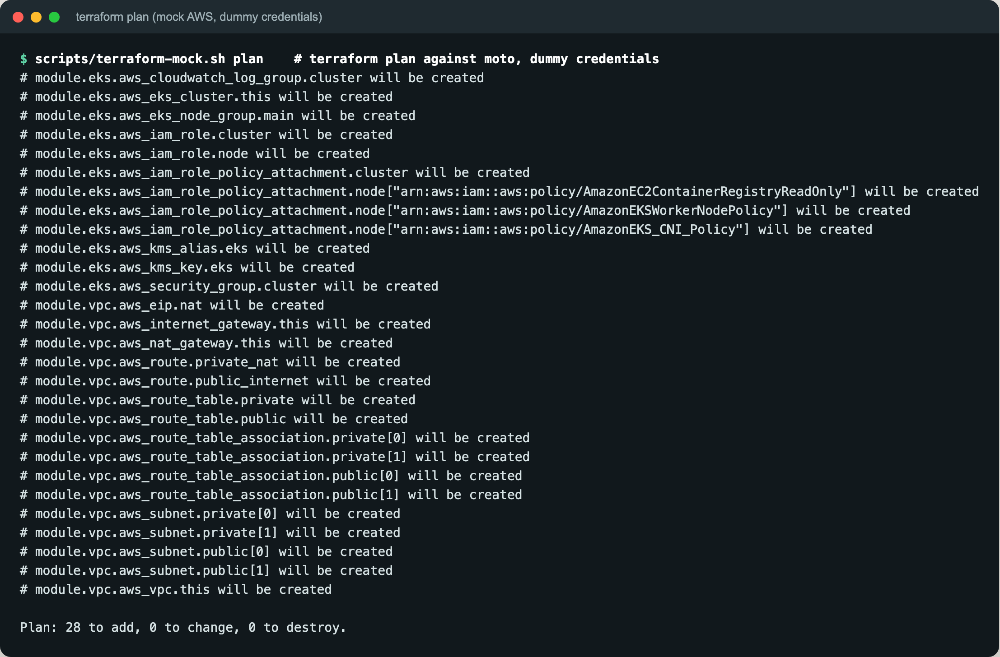 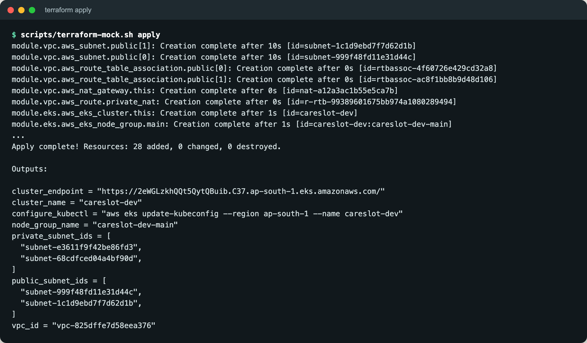
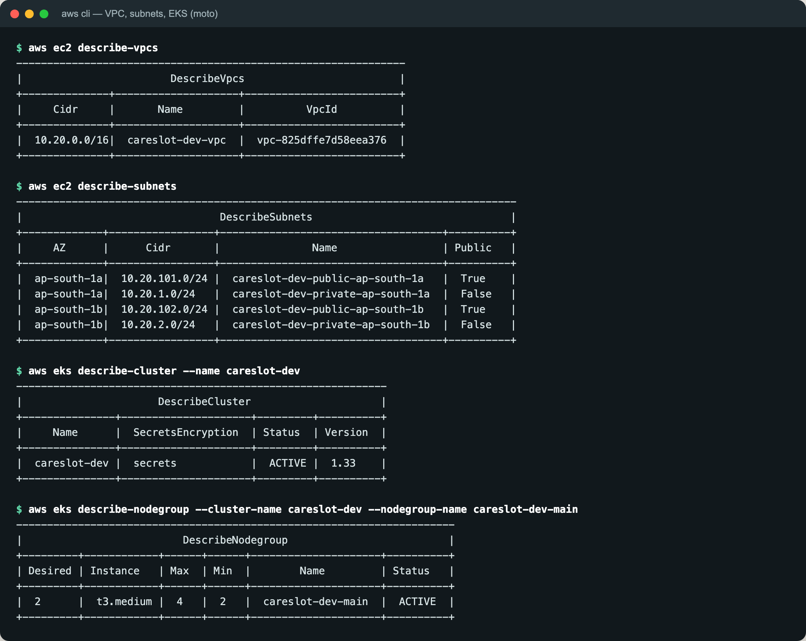 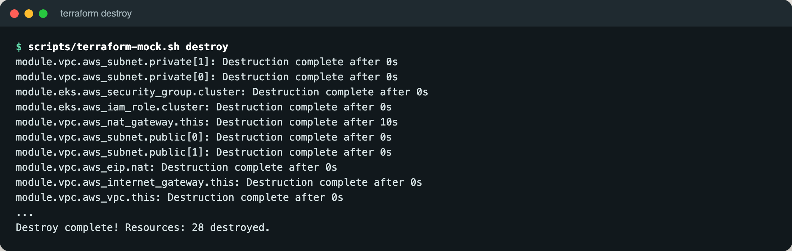

### M8 Kubernetes and Helm

| Required | Where |
|---|---|
| `k8s/` manifests | [`k8s/namespace.yaml`](k8s/namespace.yaml) (Pod Security labels), [`k8s/resource-quota.yaml`](k8s/resource-quota.yaml) |
| Helm chart | [`helm/careslot/`](helm/careslot/): `Chart.yaml`, `values.yaml`, [`templates/`](helm/careslot/templates/) |
| 2+ replicas, ClusterIP Services, Ingress `/` and `/api` | [`backend.yaml`](helm/careslot/templates/backend.yaml), [`frontend.yaml`](helm/careslot/templates/frontend.yaml), [`ingress.yaml`](helm/careslot/templates/ingress.yaml) |
| Screenshots | `kubectl get pods`, `kubectl get svc`, Ingress + HPA, `helm list` below; app through the Ingress at `careslot.local` is the first M1 screenshot |
| GitOps | [`argocd/careslot-application.yaml`](argocd/careslot-application.yaml): auto-sync, prune, self-heal |

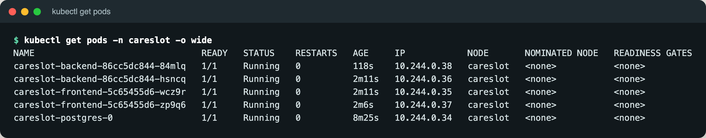 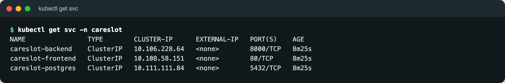
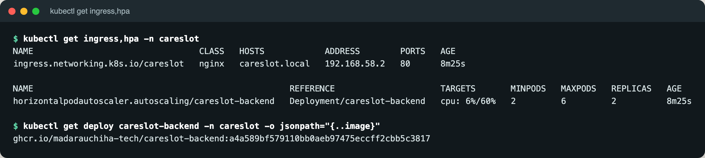 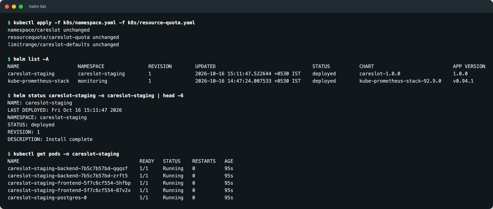
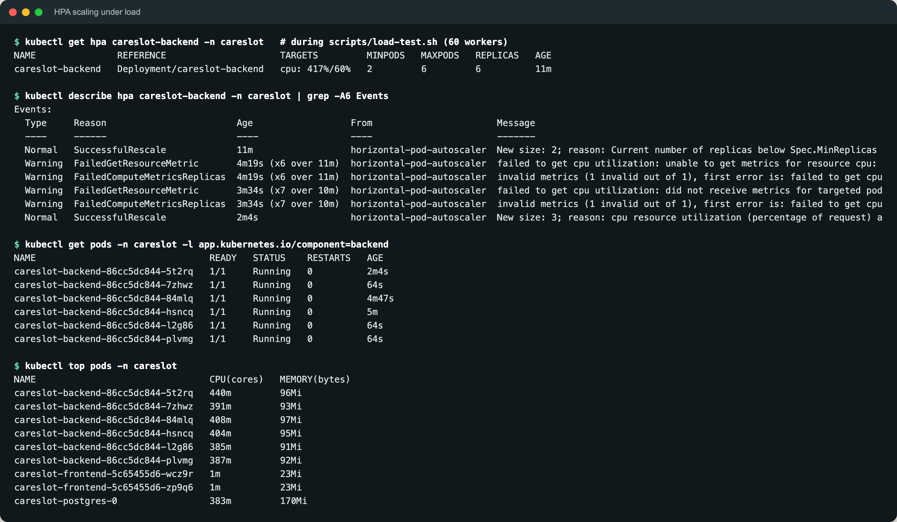 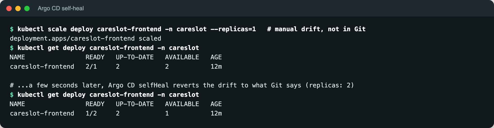
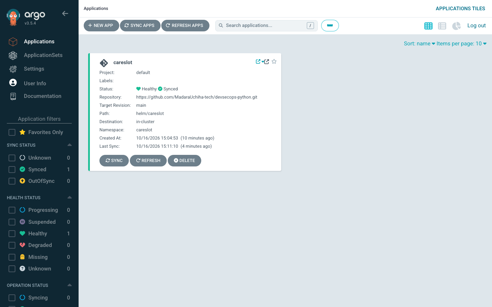 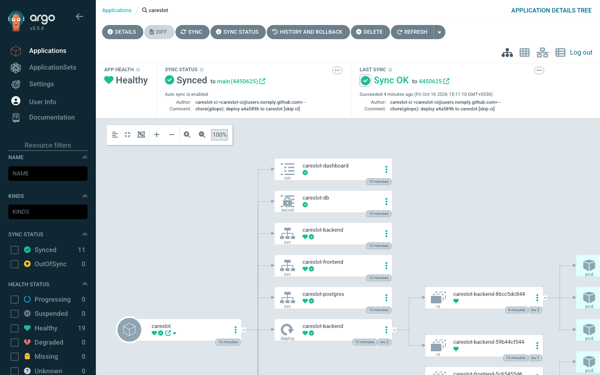

### M9 Observability

| Required | Where |
|---|---|
| `monitoring/` values files | [`monitoring/prometheus-values.yaml`](monitoring/prometheus-values.yaml), [`monitoring/grafana-values.yaml`](monitoring/grafana-values.yaml) |
| Scrape config + dashboard | [`servicemonitor.yaml`](helm/careslot/templates/servicemonitor.yaml), [`grafana-dashboard.yaml`](helm/careslot/templates/grafana-dashboard.yaml) |
| `curl /metrics` | Screenshot below · raw: [`demo/evidence/metrics-curl.txt`](demo/evidence/metrics-curl.txt) |
| Prometheus Targets UP | Screenshot below |
| Grafana dashboard | Screenshot below |

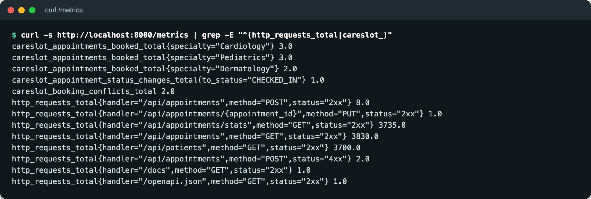 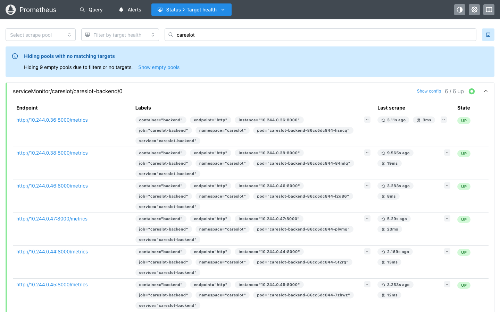
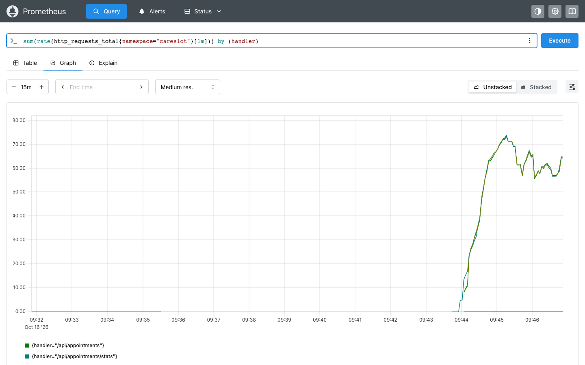 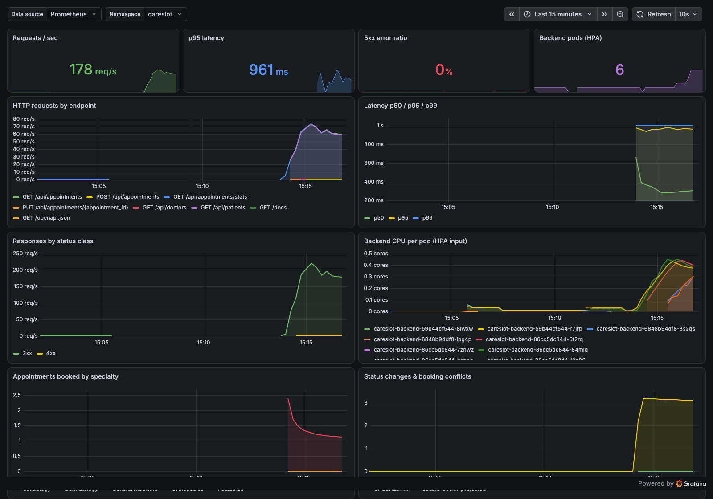

### M10 Presentation and documentation

| Required | Where |
|---|---|
| Video (MANDATORY) | [`demo/careslot-presentation.mp4`](demo/careslot-presentation.mp4): the slides, then a live walkthrough of the codebase, app, CI/CD run, Trivy, Terraform, Argo CD, Kubernetes, Prometheus and Grafana (11:50). Chapter times are in [`demo/README.md`](demo/README.md#video-chapters) |
| Slide deck (MANDATORY) | [`demo/CareSlot-presentation.pptx`](demo/CareSlot-presentation.pptx) · [`demo/CareSlot-presentation.pdf`](demo/CareSlot-presentation.pdf) (13 slides) |
| README sections | Description (top), [architecture](#1-architecture), [tech stack](#2-tech-stack), [local setup](#4-run-it-locally), [CI/CD](#7-cicd-pipeline), [Terraform](#9-terraform-aws-infrastructure), [Kubernetes/Helm](#10-kubernetes-and-helm), [observability](#11-observability), [known issues](#13-known-issues-and-limitations) |
